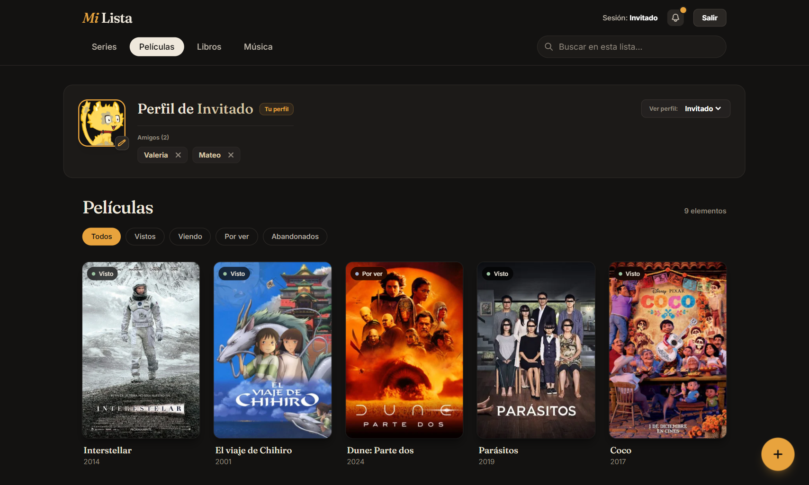

# Mi Lista

Catálogo personal de **series, películas, libros y música**. Buscas un título, lo agregas a tu lista con su estado (visto, viendo, por ver, abandonado) y puedes ver las listas de tus amigos y qué tan parecidos son sus gustos.

Fue uno de mis primeros proyectos grandes con CRUD: empezó en JavaScript puro y luego lo pasé a React.

**[mi-lista-six.vercel.app](https://mi-lista-six.vercel.app)** · se puede probar sin registrarse con **Entrar como invitado**.



---

## Qué hace

- **Cuatro secciones:** series, películas, libros y música, cada una con sus propios estados (*Visto / Viendo / Por ver* en películas y series, *Leído / Leyendo / Por leer* en libros, *Escuchado / Escuchando / Por escuchar* en música).
- **Búsqueda con autocompletado** en tres APIs gratuitas:
  - [TMDB](https://www.themoviedb.org/) para películas y series: póster, sinopsis, fecha, géneros y reparto.
  - [Open Library](https://openlibrary.org/) para libros: autor, año y portada.
  - [MusicBrainz](https://musicbrainz.org/) y Cover Art Archive para álbumes: artista, año y portada.
- **Detalle de cada elemento** con el título original, los géneros y la opción de cambiar el estado o eliminarlo.
- **Filtros** por estado y búsqueda dentro de la propia lista.
- **Amigos:** enviar, aceptar, ignorar y cancelar solicitudes, y visitar la lista de un amigo.
- **Afinidad de gustos** entre dos perfiles:
  - 70% por títulos en común del mismo tipo (el libro *Dune* no cuenta como la película *Dune*).
  - 30% por géneros de películas y series compartidos.
- **Modo invitado:** una lista de ejemplo con más de 30 títulos, dos amigos con gustos distintos (Valeria y Mateo) y una solicitud de amistad pendiente (Camila), para recorrer toda la app sin crear cuenta.

## Cómo guarda los datos

Todo vive en el `localStorage` del navegador: no hay servidor ni base de datos. Eso significa que:

- Las cuentas, listas y amistades existen **solo en el navegador donde se crearon**. La parte social funciona entre cuentas creadas en el mismo navegador; es una simulación, no una red social real.
- Las contraseñas **no se guardan en texto**: se guarda un hash SHA-256 con una sal aleatoria por usuario. Aun así, como todo está en el navegador, conviene no usar una contraseña real.
- La clave de TMDB está en el código (`src/config.js`). En una app sin servidor no se puede ocultar; para protegerla habría que pasar las búsquedas por una función de servidor.

## Tecnologías

React 19, Vite y Tailwind CSS 4.

## Uso local

```bash
cd mi-lista-app
npm install
npm run dev
```

Para generar la versión de producción: `npm run build` (queda en `mi-lista-app/dist`).

## Estructura

```
mi-lista/
├── docs/              # Captura del README
└── mi-lista-app/
    ├── public/        # Ícono
    └── src/
        ├── components/  # Interfaz: navegación, perfil, catálogo, ventanas de agregar y detalle
        ├── data/demo.js # Lista de ejemplo del modo invitado
        ├── lib/auth.js  # Registro e inicio de sesión con contraseñas cifradas
        ├── config.js    # Clave de TMDB
        └── App.jsx      # Estado de la app y lógica de listas y amigos
```

---

Sneider Araque
